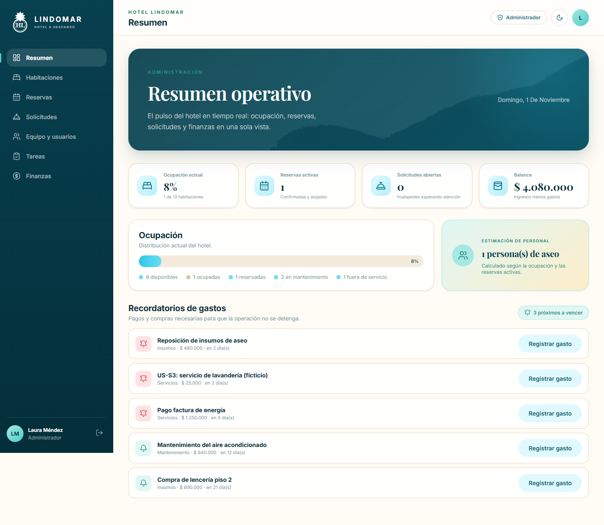
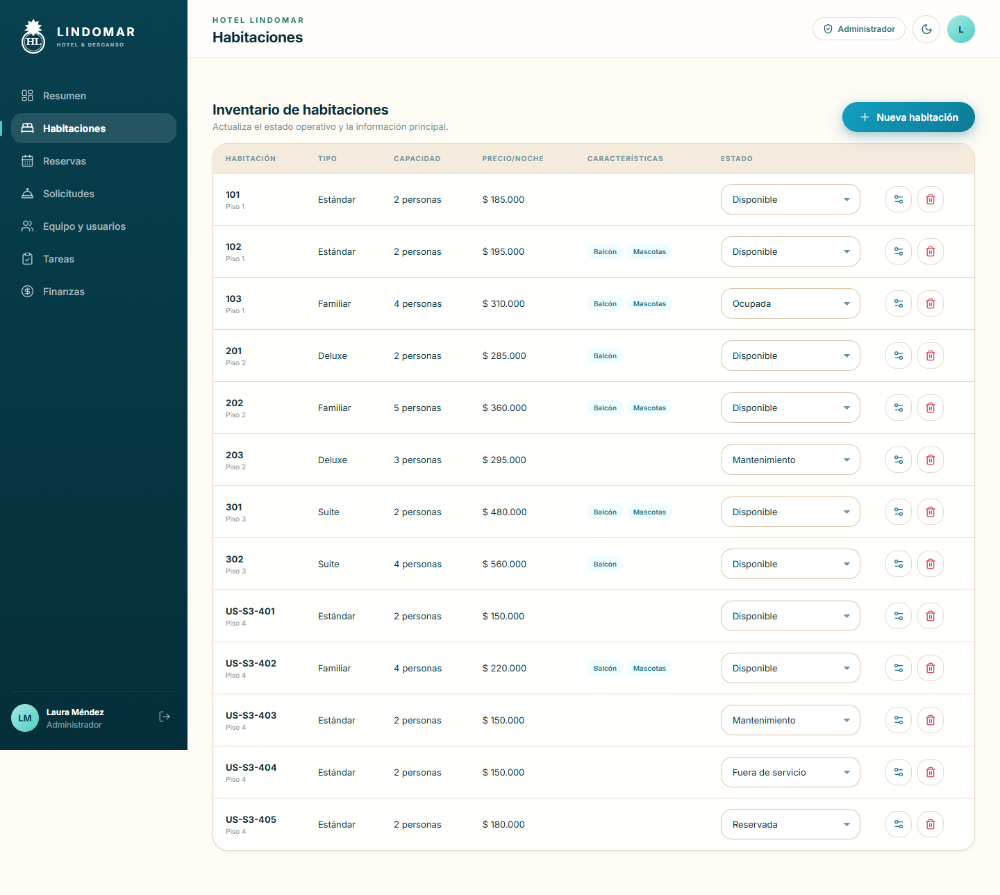
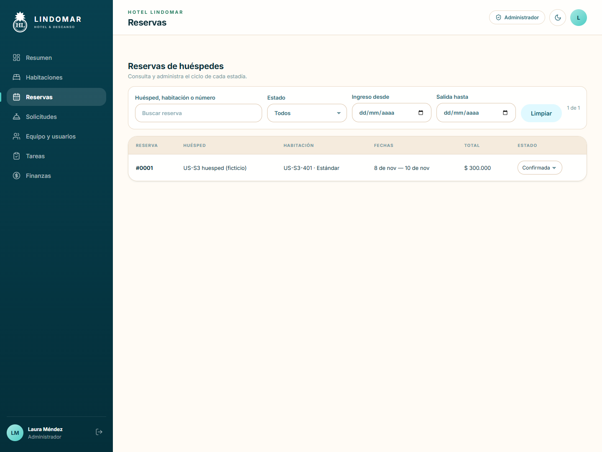
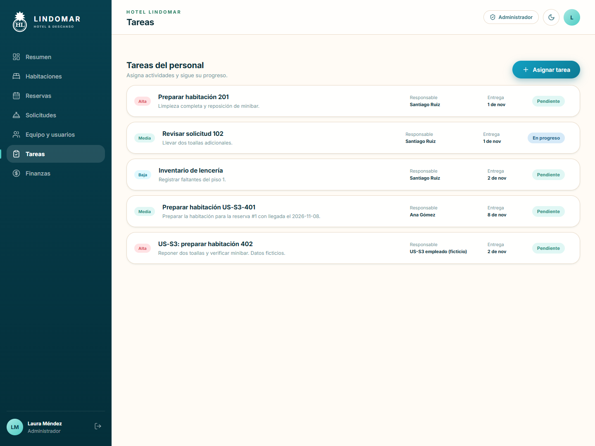
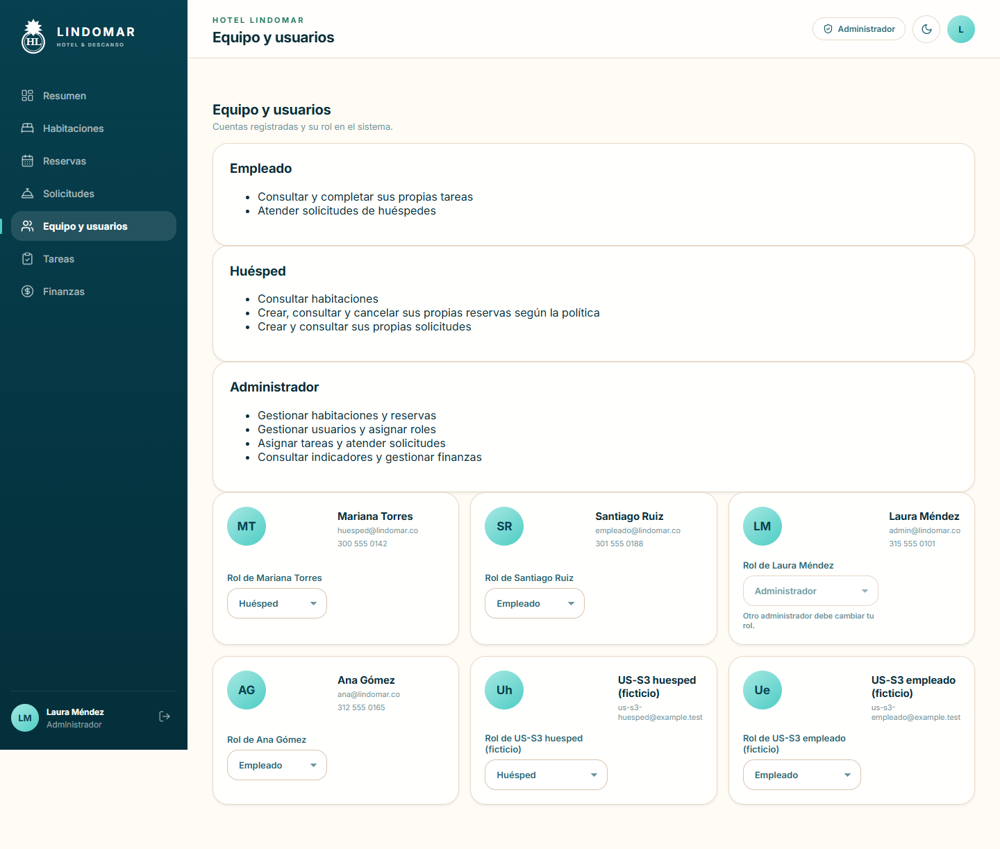
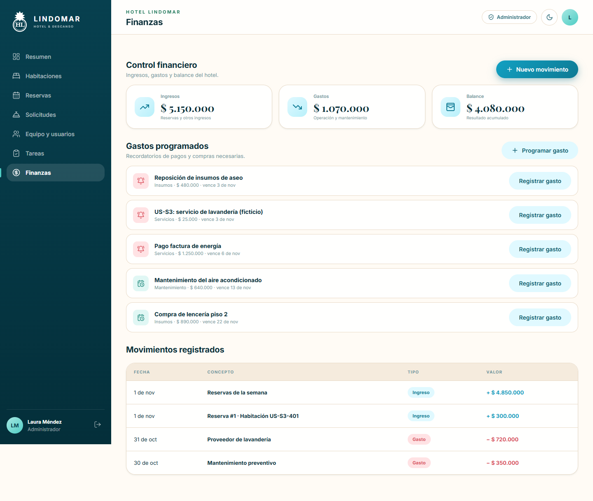
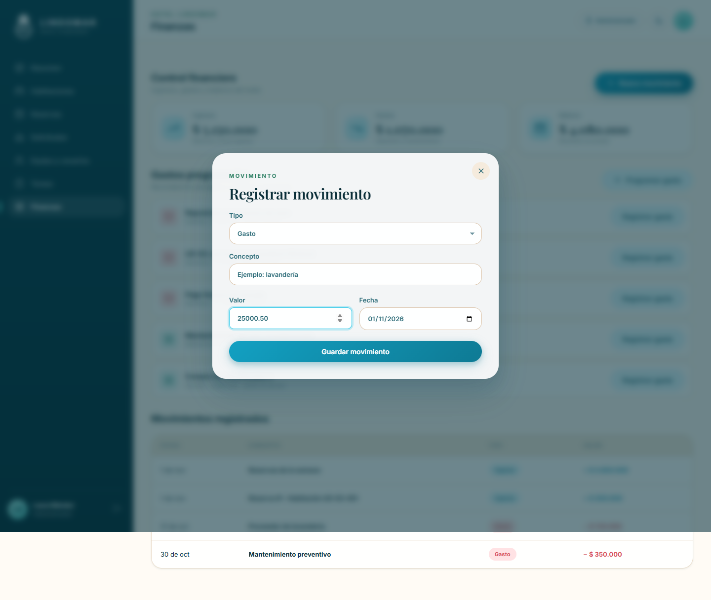
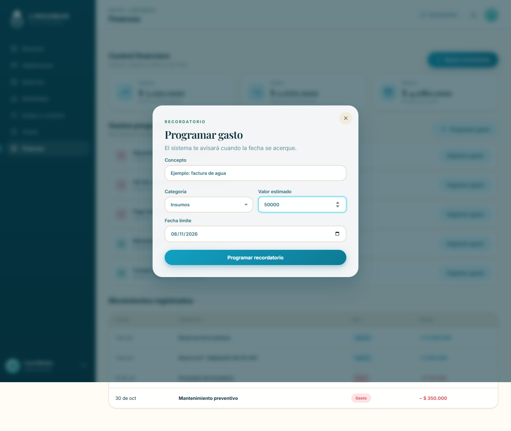

# Manual de usuario: administrador de Hotel Lindomar

Versión de trabajo del Sprint 3. Responsable: Julián. Revisión de estilo e integración
con los manuales de huésped y empleado: Alyson. Capturas tomadas en un entorno
local con información ficticia; los nombres y valores no representan la operación real.

## Entrar y orientarse

Abre la dirección del hotel e ingresa tu correo y contraseña de administrador.
Si usas el entorno de demostración local, la cuenta es `admin@lindomar.co` con
`demo123`. Estas credenciales no corresponden al despliegue AWS preparado.
En un celular, usa el botón de menú para abrir las secciones.

En **Resumen** aparecen ocupación, reservas, solicitudes, tareas y balance.
Las tarjetas de estado distinguen disponible, ocupada, reservada, mantenimiento
y fuera de servicio. «Reservada» es un bloqueo operativo de la habitación; una reserva
con fechas controla la disponibilidad para su propio período.

## Habitaciones: crear, editar y cambiar estado

1. Abre **Habitaciones** y selecciona **Nueva habitación**.
2. Ingresa número único, tipo, piso, capacidad y precio por noche. Completa servicios,
   balcón y mascotas según corresponda. La fotografía, si se proporciona, debe ser
   un enlace HTTPS válido.
3. Revisa y guarda. Para corregir una habitación, usa **Editar** en su fila.
4. Para un cambio operativo, selecciona el estado de la habitación y comprueba
   que la fila muestre el nuevo valor.

Si una habitación tiene reservas activas, el sistema impide retirarla a mantenimiento
o fuera de servicio. Resuelve primero esas reservas de acuerdo con la política del
hotel. No borres habitaciones con historial: conserva la trazabilidad y utiliza los
estados operativos disponibles. El borrado de una habitación sin historial pide confirmación.

## Reservas: consultar, ingresar, finalizar y cancelar

1. Abre **Reservas**. Busca por huésped, habitación o número; también puedes filtrar
   por estado o fechas. **Limpiar** elimina los filtros.
2. Revisa huésped, habitación, fechas, total y estado antes de actuar.
3. Una reserva confirmada puede pasar a **Alojado** durante las fechas de la estadía,
   si la habitación está operativa. Una estadía alojada puede pasar a **Finalizada**.
4. Para cancelar una reserva elegible, selecciona **Cancelar** y revisa la confirmación
   y el importe de reembolso. Si aceptas, verifica el estado Cancelada y el reembolso
   en Finanzas. Si ya venció el plazo, la aplicación informa el motivo y no la cancela.

La política actual permite cancelar antes de las dos horas previas al check-in de
las 15:00: **antes de las 13:00 del día de llegada, hora de Colombia**. Se devuelve el
importe registrado una sola vez. La configuración del hotel puede cambiar esa política;
consulta la información que muestra tu reserva. Cancelar no elimina el historial.
La modificación de fechas/habitación de HU-10 no está habilitada en este alcance.

## Tareas del personal

1. Abre **Tareas** y selecciona **Asignar tarea**.
2. Escribe título y descripción claros, elige un empleado, una fecha límite desde hoy
   y prioridad Alta, Media o Baja.
3. Guarda y verifica responsable, entrega y estado Pendiente.
4. Consulta el avance: el empleado debe iniciar la tarea antes de completarla. Si adjuntó
   una fotografía de finalización, usa **Ver evidencia**.

Solo las cuentas con rol Empleado reciben tareas. Si una tarea automática no tiene
responsable, primero debe existir un empleado; luego utiliza **Asignar responsable**.
La preparación de reservas y la limpieza al liberar una habitación pueden generar
tareas automáticamente: revisa la lista antes de crear una tarea equivalente.

## Equipo, usuarios y permisos

1. Abre **Equipo y usuarios**. Revisa los permisos visibles por rol.
2. Ubica a la persona por su nombre y correo; verifica que sea la cuenta correcta.
3. Selecciona el rol correspondiente y confirma el cambio cuando la interfaz lo solicite.
4. Pide a la persona que vuelva a iniciar sesión: sus sesiones anteriores se invalidan.

Huésped: sus reservas y solicitudes. Empleado: sus tareas y atención de solicitudes.
Administrador: operación, usuarios y finanzas. No puedes cambiar tu propio rol;
otro administrador debe hacerlo. El sistema mantiene al menos un administrador.

## Finanzas: movimientos y balance

**Finanzas** muestra ingresos, gastos y balance acumulado. El balance corresponde
a ingresos menos gastos; un recordatorio pendiente todavía no es un gasto real.
La confirmación de una reserva registra su ingreso automáticamente; no lo vuelvas
a registrar manualmente. La cancelación elegible genera su reembolso.

Para un movimiento manual:

1. Selecciona **Nuevo movimiento**.
2. Elige Ingreso o Gasto, escribe un concepto identificable y un valor **mayor que cero**.
   Se permiten hasta dos decimales; el tipo indica si entra o sale dinero.
3. Selecciona la fecha real, hasta hoy, y pulsa **Guardar movimiento** una vez.
4. Comprueba el movimiento y el balance. Si aparece un error, corrige los datos;
   el formulario conserva lo ingresado. No uses importes negativos para representar gastos.

## Programar y atender un gasto

1. En Finanzas, selecciona **Programar gasto**.
2. Indica concepto, categoría, valor estimado positivo y fecha límite desde hoy.
3. Pulsa **Programar recordatorio**. El aviso aparecerá entre los gastos pendientes;
   los próximos a vencer se resaltan también en Resumen.
4. Cuando el gasto realmente ocurra, pulsa **Registrar gasto** en el recordatorio
   correcto. Revisa concepto e importe en la confirmación y acepta si corresponden.
5. Comprueba que desapareció de pendientes y que hay un gasto en Movimientos.

Mientras se procesa el pago, el botón indica «Registrando…». Un reintento del mismo
recordatorio conserva el movimiento original, sin duplicar su gasto. Si el sistema
informa que un recordatorio antiguo ya fue atendido, revisa el historial; no crees un
movimiento manual sin comprobar antes si el gasto ya existe.

## Solicitudes y cierre de sesión

En **Solicitudes**, consulta las necesidades de los huéspedes y cambia el estado
cuando corresponda. Revisa que se resolvió la petición antes de marcarla Resuelta.
Al terminar, usa el icono de salida junto a tu nombre. Si la sesión vence o cambian
tu rol, vuelve a ingresar; si el acceso no corresponde a tus funciones, consulta al
administrador responsable.

## Si algo no funciona

| Mensaje o situación | Qué hacer |
|---|---|
| No aparece información o hay error de conexión | Comprueba internet, vuelve a la sección y, si continúa, reporta pantalla y hora al soporte. |
| Fecha o importe inválido | Revisa los límites indicados; no cambies el reloj del equipo para intentar guardar. |
| Habitación no disponible / conflicto de fechas | Revisa la reserva y disponibilidad; no fuerces un estado operativo para evitar el conflicto. |
| Rol no permite la acción | Verifica tu perfil y consulta a otro administrador. |
| Duda sobre un movimiento financiero | Comprueba el historial y el concepto antes de repetir una operación. |

Este manual cubre el perfil administrador y debe revisarse con una persona del
hotel antes de entregarlo al cliente. El manual global debe incorporar también los
recorridos de huésped y empleado del resto del equipo.
